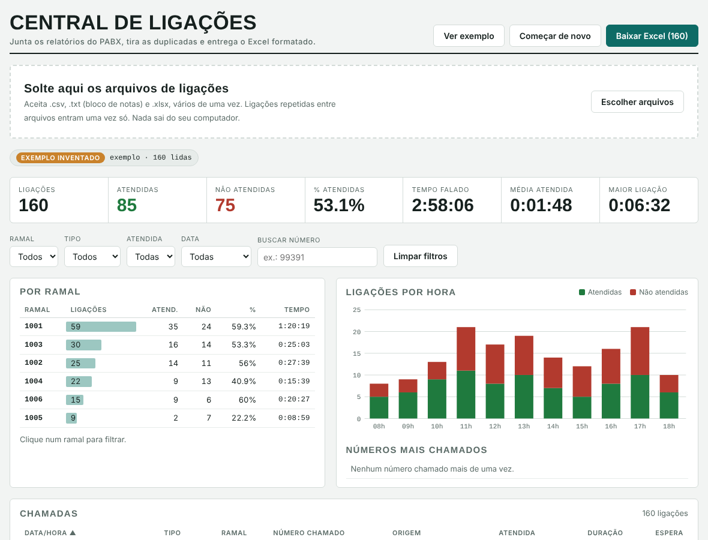

# Central de Ligações

Ferramenta para transformar os relatórios de ligações do PABX (arquivos `.csv`, `.txt` ou `.xlsx`) em um **painel de análise** e em um **Excel formatado**, sem digitar nada à mão.

*English summary: a small tool that merges PBX call-log exports, removes duplicates and builds an analysis dashboard and a formatted Excel report. Two versions: a browser-only web app (no server, nothing leaves your computer) and a Python script.*



> Os dados da imagem são **inventados**, gerados pelo botão "Ver exemplo".

## O problema

O PABX exporta as chamadas em arquivos soltos, às vezes com linhas repetidas entre um relatório e outro. Para saber quantas ligações foram atendidas, por ramal, por hora e quais números mais se repetem, era preciso juntar tudo e montar tabelas e gráficos manualmente no Excel.

## O que faz

- Junta vários arquivos de uma vez e **remove ligações duplicadas** entre eles.
- Mostra indicadores: total de ligações, atendidas, não atendidas, % de atendimento, tempo falado, média e maior ligação.
- Quebra por **ramal**, por **tipo** (saída, entrada, interna) e por **hora do dia**.
- Lista os **números mais chamados**.
- Filtra por ramal, tipo, atendida, data e número.
- Gera um **Excel** com abas de Resumo (fórmulas, gráficos) e Chamadas (tabela filtrável).

## Duas formas de usar

### 1. Painel no navegador (`src/index.html`)

Abra o arquivo no navegador, solte os relatórios na área tracejada e clique em **Baixar Excel**. Tudo roda no seu computador: **nenhum dado é enviado para servidor**. Usa a biblioteca [ExcelJS](https://github.com/exceljs/exceljs) (MIT), carregada por CDN. O botão **Ver exemplo** mostra a ferramenta com dados inventados.

### 2. Script Python (`src/gerar_excel_ligacoes.py`)

```bash
pip install -r requirements.txt
python src/gerar_excel_ligacoes.py sample_data/exemplo_ligacoes.csv saida.xlsx
```

É possível passar vários arquivos antes do nome de saída:

```bash
python src/gerar_excel_ligacoes.py relatorio1.txt relatorio2.csv ligacoes.xlsx
```

## Formato esperado

Colunas na ordem do relatório do PABX: data, hora, tipo da chamada (`A originar`, `A finalizar`, `Intra BG`), número de origem, ramal, número chamado, ramal de destino, chamada conectada (`Sim`/`Não`), duração e tempo de espera. Veja `sample_data/exemplo_ligacoes.csv`.

## Decisões técnicas

- **Privacidade primeiro:** o processamento do painel é todo local, no navegador.
- **Deduplicação por chave:** data/hora, tipo, origem, destino, duração e status identificam a ligação.
- **Excel com fórmulas reais:** a aba Resumo usa fórmulas sobre a aba Chamadas, então o arquivo continua correto se alguém editar os dados.
- **Leitura tolerante:** aceita separadores `,` `;` e tab, e as codificações UTF-8 e Windows-1252.

## Privacidade

Não suba relatórios reais de ligações para o repositório: eles contêm números de telefone de clientes. O `.gitignore` já bloqueia `.csv`, `.txt` e `.xlsx` fora da pasta `sample_data/`. Os dados de exemplo deste projeto são inventados.

## Licença

MIT. Veja [LICENSE](LICENSE).
